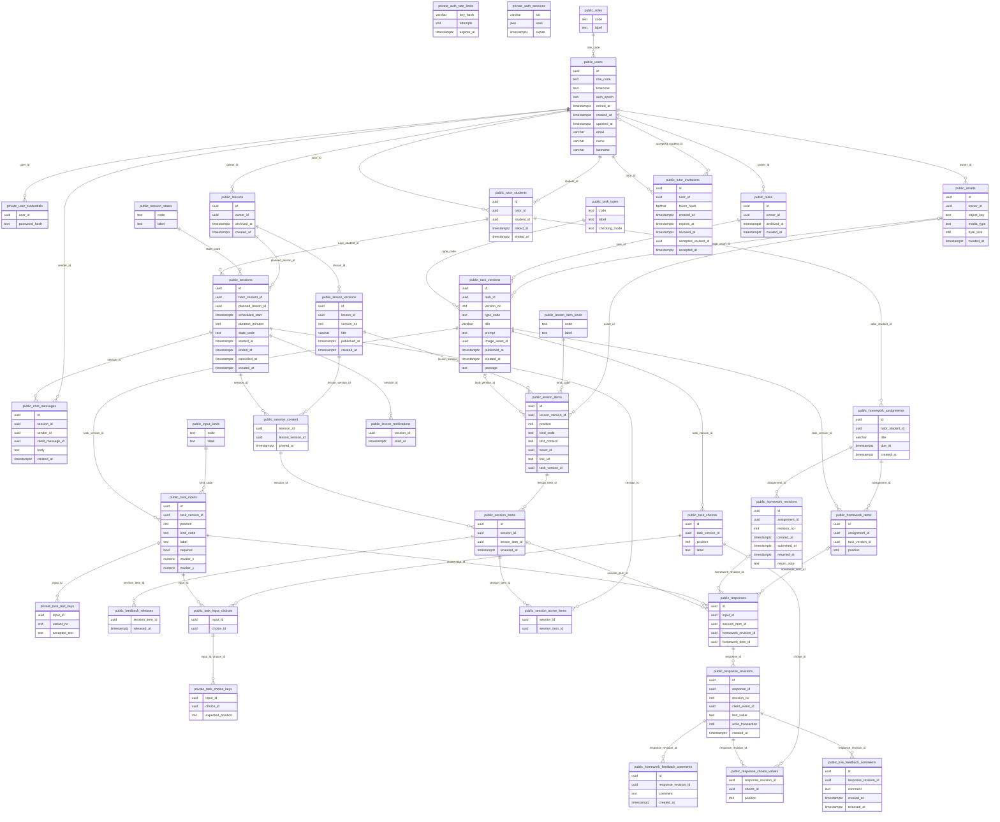

# Logical database schema

All 37 relations and every foreign key are shown below. `o|` marks an optional parent; each parent can have zero or many dependent rows unless the key/unique constraints listed in the dictionary limit this to one. Composite foreign keys are labelled with all participating columns.

Conditional uniqueness, context XOR rules and lifecycle constraints are detailed in [the data dictionary](data-dictionary.md) and [advanced features](advanced-features.md).
