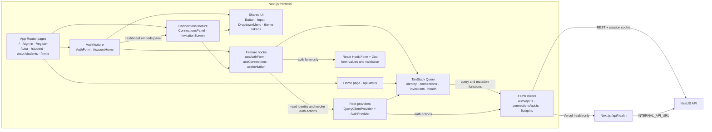
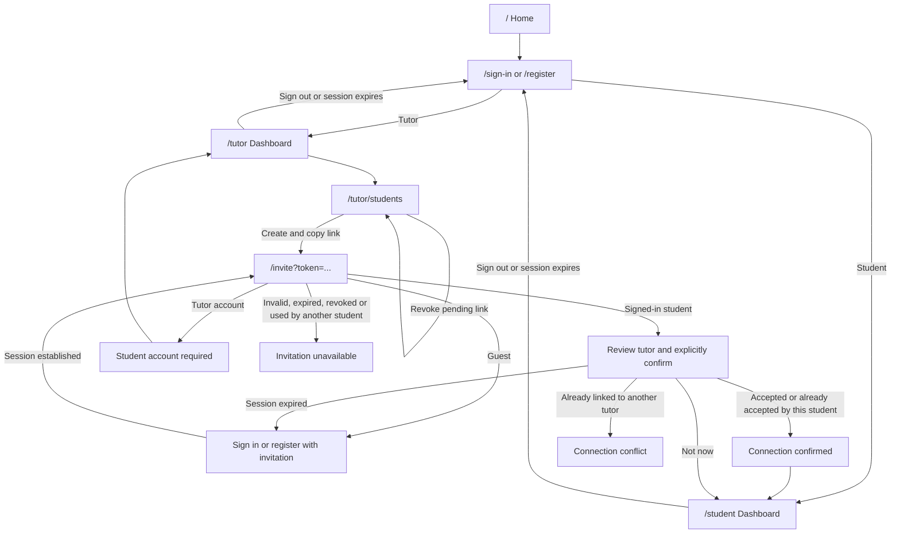

# Online Tutor frontend architecture specification

Current scope is US01–US03: registration, sign-in/sign-out, role-specific dashboards, and tutor–student connections through invitations. Lesson creation, classroom, homework and scheduling remain planned. The home page includes an API liveness indicator.

## Application architecture



## Architecture approach

The client is a single component-based Next.js application. Files in [app](src/app) define routes and load feature components. [Auth](src/features/auth) and [connections](src/features/connections) colocate screens, hooks, API adapters and tests. Components render the view and call handlers. Hooks orchestrate forms, queries and mutations. API adapters handle HTTP and translate responses for the UI. Shared controls and theme tokens live in [components/ui](src/components/ui) and [globals.css](src/app/globals.css).

| State | Owner and lifetime |
| --- | --- |
| Signed-in identity | AuthProvider exposes TanStack Query's `['auth', 'session']` result through React Context. Identity is checked on focus and every 60 seconds. Explicit identity changes and connection-session expiry clear other cached queries. |
| Connection and invitation lists | TanStack Query scopes lists to the signed-in user, refreshes every 15 seconds while in use, and invalidates relevant queries after mutations. |
| Invitation preview | Query scoped to user and token. Confirmation is an explicit mutation. |
| Form and interaction state | React Hook Form owns form values and validation; React state handles view details such as password visibility and copy feedback. |
| Session | NestJS owns the session. Browser sends the HttpOnly cookie through credentialed requests. |
| Navigation context | App Router controls routes. A validated invitation token survives switching between sign-in and registration, then returns the user to confirmation. |

## Implemented navigation



Wrong-role dashboard visits redirect to the account's own dashboard. The tutor sees connected students and invitation statuses. The student sees their connected tutor. Both see loading, empty and error states where applicable. The [design screen map](../../Design/online-tutor/screen-map.csv) covers the broader diploma design.

## REST contract used by the frontend

Local API base defaults to `http://localhost:3001/api`. On Vercel the default is same-origin `/api`. `NEXT_PUBLIC_API_URL` can override either. The client uses `credentials: 'include'`, sends JSON bodies with `Content-Type: application/json`, and the API checks browser mutation origins against `CLIENT_ORIGIN`.

Swagger UI and JSON are at `/api/docs` and `/api/docs-json` on the API host. Paths below are relative to the API base.

| Method and path | Request | Success |
| --- | --- | --- |
| GET /health | No body | 200 Health |
| POST /auth/register | Register JSON below | 201 Auth response and session cookie |
| POST /auth/login | Login JSON below | 200 Auth response and session cookie |
| GET /auth/me | Session cookie | 200 Auth response |
| POST /auth/logout | Current session cookie, if present | 204, clears cookie |
| GET /connections | Session cookie | 200 Connection array, possibly empty |
| POST /connections/invitations | Tutor session, no body | 201 Invitation with token |
| GET /connections/invitations | Tutor session | 200 Invitation array, latest 100 |
| DELETE /connections/invitations/{id} | Tutor session and invitation UUID | 204, empty body |
| POST /connections/invitations/preview | Student session and Token JSON below | 200 Preview |
| POST /connections/invitations/accept | Student session and Token JSON below | 200 Connection |

### Request examples

Registration requires name, last name, email, password and fixed role (`TUTOR` or `STUDENT`). Names are trimmed and support international letters. Registration password minimum is five characters. Confirmation is checked in the browser and stays out of the request.

```json
{"name":"Alex","lastname":"Rivera","email":"alex@example.test","password":"example-password","role":"STUDENT"}
```

Login uses email and password:

```json
{"email":"alex@example.test","password":"example-password"}
```

Invitation preview and accept use the same body. Tokens contain 64 lowercase hexadecimal characters:

```json
{"token":"0123456789abcdef0123456789abcdef0123456789abcdef0123456789abcdef"}
```

### Response examples and data shapes

IDs are UUID strings and timestamps are ISO 8601 strings. Auth response wraps the signed-in user. Connection person fields contain ID, name and last name only.

```json
{"user":{"id":"9bde4480-bcc5-4159-8c74-304e887bbd67","name":"Alex","lastname":"Rivera","email":"alex@example.test","role":"STUDENT"}}
```

A connection contains its ID, the other participant and the link timestamp. List wraps this shape in an array:

```json
{"id":"34655f8e-098a-4850-9d61-77d23e80b730","person":{"id":"9bde4480-bcc5-4159-8c74-304e887bbd67","name":"Alex","lastname":"Rivera"},"linkedAt":"2026-11-24T12:30:00.000Z"}
```

An invitation has status `pending`, `accepted`, `revoked` or `expired`. Creation alone includes the raw token. Listing returns an array with ID, expiry and status.

```json
{"id":"155c82f8-cc58-4ad4-818b-3620fd2b6593","expiresAt":"2026-12-01T12:00:00.000Z","status":"pending","token":"0123456789abcdef0123456789abcdef0123456789abcdef0123456789abcdef"}
```

Preview identifies the tutor and whether the caller already accepted:

```json
{"tutor":{"id":"9bde4480-bcc5-4159-8c74-304e887bbd67","name":"Alex","lastname":"Rivera"},"expiresAt":"2026-12-01T12:00:00.000Z","accepted":false}
```

Health returns `{"status":"ok","service":"api"}`. On Vercel, Next.js proxies this route through `INTERNAL_API_URL` and returns 503 with `{"status":"unavailable"}` if the upstream check fails. This proxy is part of the frontend deployment. Swagger describes the NestJS health endpoint.

### Error handling

| Status | Meaning for the client |
| --- | --- |
| 400 | Invalid request body or invitation ID. Validation errors may carry a message array. |
| 401 | Invalid credentials or missing/expired session. The current-user client treats 401 as signed out. |
| 403 | Role restriction or disallowed request origin. |
| 404 | Invitation unavailable to this caller. |
| 409 | Registration email already used, or student already connected to another tutor. |
| 429 | Login/registration attempt limit reached. |
| 503 | Authentication, session or connection storage unavailable, or Vercel health proxy upstream unavailable. |

Domain error example:

```json
{"statusCode":409,"code":"already_connected","message":"You are already connected to another tutor."}
```

Nest validation error example:

```json
{"statusCode":400,"error":"Bad Request","message":["password must be a string"]}
```

Invitations expire after seven days and can be used by one student. Same-student retries return the same active connection. The backend owns authorization and atomic acceptance. The Socket.IO client helper exists for future classroom screens. Current pages do not call it.

## Tech stack justification

| Choice | Why it fits this project |
| --- | --- |
| React + Next.js App Router | React composes reusable controls and feature screens. Next.js provides file-based routing, layouts, deployment integration and the health route handler. Learning Next.js is also a project goal. |
| TypeScript | Makes DTOs, roles, component props and API calls explicit and catches mismatches during type-checking. |
| TanStack Query + React Context | Query owns remote data, mutations, refresh and invalidation. Context exposes identity and auth actions to screens without copying identity into a second store. |
| React Hook Form + Zod | Form state and field errors stay near the auth flow. Zod validates form input and checks connection API response shapes at runtime. |
| shadcn/ui + Radix + Tailwind | Shared controls keep button/input behavior consistent. Radix powers dropdown interactions. The official CLI installs component source into the repository. Tailwind classes and theme tokens adapt that source to the light Figma design across desktop and phone. |
| Jest, React Testing Library and Cypress | Component tests cover form and invitation states. Browser tests exercise desktop and phone navigation with controlled API fixtures. |
